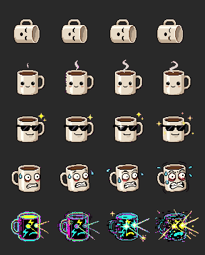

# ☕ JitterBar

> **Real-Time Pharmacokinetic Caffeine Monitor & Procedural Pixel Art for the macOS Menu Bar.**  
> Zero external runtime dependencies. Strict nearest-neighbor Retina scaling. Zero mercy for your sleep schedule.

<p align="center">
  
</p>

---

## What is JitterBar?

Most macOS "Caffeine" apps are sleep-prevention utilities that call `caffeinate(8)` to keep your screen awake.  
**JitterBar monitors human systemic caffeine pharmacokinetics in real time**, displaying your metabolic intoxication state through an animated 16×16 / 20×20 pt pixel-art mug directly in your menu bar.

As your active caffeine to Lean Body Mass ratio changes, the status icon cycles across **5 physiological stages**, shifting animation frames, altering dynamic FPS (from 1 FPS to a violent 20 FPS kernel panic), and applying procedural coordinate jitter so the mug physically shakes in the macOS status bar.

---

## 1. The Pharmacokinetic Engine

Dividing caffeine by total body weight is for amateurs. Caffeine is hydrophilic ($V_d \approx 0.6 - 0.7\text{ L/kg}$) and distributes predominantly across **intracellular water**, leaving adipose tissue unburdened.

### Boer Formula (Lean Body Mass)
$$LBM = 0.407 \cdot W + 0.267 \cdot H - 19.2$$

Your Height ($cm$) and Weight ($kg$) are calibrated via the menu dropdown and persisted locally in `~/.jitterbar.json`.

### Exponential Elimination Decay
Every beverage logged carries an initial dose $C_i$ and epoch timestamp $t_i$. Systemic active caffeine is computed via half-life ($t_{1/2} = 5.0\text{ h}$):

$$C(t) = \sum C_i \cdot (0.5)^{\frac{t - t_i}{5.0}}$$

### The Sleep Radar
Solving analytically for when active caffeine clears the clinical REM sleep threshold ($40\text{ mg}$):

$$\Delta t = 5.0 \cdot \log_2\left(\frac{C(t)}{40.0}\right)$$

The menu displays an exact circadian clearance clock:  
`🌙 Circadian Clearance: 02:45 AM (Good luck sleeping before then).`  
If already below $40\text{ mg}$, it authorizes sleep: `Sleep Clearance: Authorized.`

---

## 2. Physiological Stages & Dynamic FPS

| Stage | Intensity ($mg/kg$ LBM) | FPS | Sprite Behavioral State | Status Text |
| :--- | :--- | :---: | :--- | :--- |
| **0** | `0.0 – 0.3` | **1** | **Clinical Coma / Decaffeinated Husk:** Knocked-over mug lying horizontally with floating cyan $z$'s. | *"Bloodstream contains only water and mild existential dread. System idling."* |
| **1** | `0.3 – 1.5` | **3** | **Functional Member of Society:** Upright cheerful mug, blushing cheeks, rising sine-wave steam, blinking. | *"Cognitive baseline achieved. You can safely make eye contact with coworkers."* |
| **2** | `1.5 – 3.0` | **6** | **10x Engineer / Unwarranted Confidence:** Pitch-black 8-bit "Deal With It" shades, smirk, sliding glare, corner sparkles. | *"Peak velocity. Dangerously close to rewriting the backend in Rust on a Friday afternoon."* |
| **3** | `3.0 – 5.0` | **12** | **Tachycardia Simulator (Jitter Mode):** Wide bloodshot eyes, clenched teeth, flying sweat droplets, **procedural coordinate shake** ($\pm 1\text{px}$). | *"You can hear colors and taste keyboard switches. Resting heart rate has entered orbit."* |
| **4** | `5.0+` | **20** | **Interdimensional Rift / Kernel Panic:** Alternating neon strobe, cyan/yellow electricity, eye laser beams, violent coordinate jitter. | *"WARNING: Temporal causality compromised. Step away from the terminal and drink water immediately."* |

---

## 3. Pixel Engine & Zero-Asset Architecture

* **Nearest-Neighbor Scaling:** Built with strict `interpolationQuality = .none` and `imageInterpolation = .none`. Pixel art remains razor-sharp on both 1× and 2× Retina screens.
* **Chroma-Key Magenta Purge:** AI-generated sprites often contain `#F904FA` fringe. The runtime loader filters out artifact halos while preserving eye lasers, electricity, and cup outlines.
* **Self-Contained Fallback:** The sprite sheet is baked directly into the single Swift source as an embedded Base64 payload. If the external `.png` is absent or moved, the executable runs completely standalone with zero missing assets.

---

## 4. Quick-Inject Beverage Menu

Log standard doses with one click or keyboard shortcuts:
* `☕ Single Espresso (63 mg)` — *"Warm up the compiler"*
* `☕☕ Double Espresso (125 mg)` — *"Overclock the central nervous system"*
* `🫖 V60 / Pour-Over (150 mg)` — *"Artisanal palpitations"*
* `🧊 Cold Brew (200 mg)` — *"Liquid panic attack"*
* `🍵 Black Tea (45 mg)` — *"Gentle micro-dose"*
* `↩︎ Undo Last Dose` — Revert accidental clicks with timestamp history.
* `🧹 Flush Liver` — Resets all logged doses.
* `🧪 Test Overdrive` — Preview individual stages or cycle through all 5 stages.

---

## 5. Build & Installation

Requires macOS 12+ and Xcode Command Line Tools (`swiftc`).

### Option A: Build and run as a dock-less `.app`
```bash
git clone https://github.com/intelava/JitterBar.git
cd JitterBar
./build.sh
open JitterBar.app
```

### Option B: Single-file direct compile
```bash
swiftc -O -swift-version 5 JitterBar.swift -o JitterBar
./JitterBar &
```

### Diagnostics & Sprite Sheet Export
Export all 20 sliced frames and the dark-mode contact sheet:
```bash
./JitterBar --dump-sprites /tmp/jitterbar_sprites
open /tmp/jitterbar_sprites/contact_sheet.png
```

---

## License

[MIT](LICENSE) © [intelava](https://github.com/intelava)
