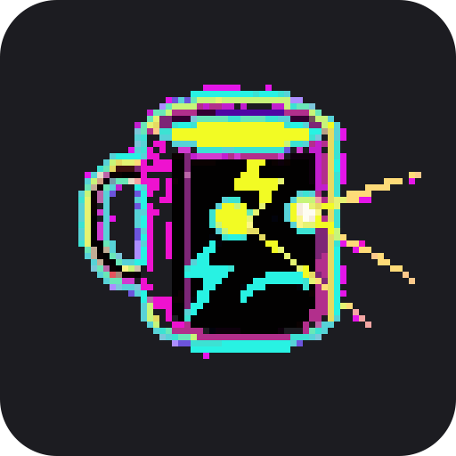

<p align="center">
  
</p>

<h1 align="center">JitterBar</h1>

<p align="center">
  A caffeine tracker for the macOS menu bar.<br/>
  It estimates how much caffeine is active in your body right now, and shows it as an animated pixel-art mug.
</p>

---

## What it does

- **Live caffeine level.** The menu bar shows your active caffeine in mg, next to a 20×20 pt pixel-art mug that changes with your level.
- **One-click logging.** The most common coffee orders sit at the top of the menu (⌘1–⌘6), with tea, energy drinks and other options under *More Drinks*.
- **Custom drinks.** Enter any amount, optionally name it, backdate it ("30 minutes ago") and save it to the menu for next time.
- **Sleep estimate.** Shows when your active caffeine will drop below 40 mg, a level that's unlikely to disturb sleep.
- **Daily total.** Tracks today's intake against the commonly cited 400 mg/day limit for healthy adults.

## The menu

```
 142 mg active                         Focused
 ━━━━━━━━━━━━━━━━━━━━━━━━━━━━━━━━━━━━━━━━━━━━━
 Peak focus. A good window for hard problems.
 Sleep-friendly                  after 1:45 AM
 Today                           271 of 400 mg
 2.4 mg/kg lean body mass · 5 h half-life
─────────────────────────────────────────────
 Add Drink
   Espresso                          63 mg  ⌘1
   Double Espresso                  126 mg  ⌘2
   Americano                        126 mg  ⌘3
   Latte / Cappuccino / Flat White  126 mg  ⌘4
   Filter Coffee (350 ml)           140 mg  ⌘5
   Cold Brew (470 ml)               200 mg  ⌘6
   <your saved drinks>
   More Drinks                               ▸
   Custom Drink…                            ⌘N
─────────────────────────────────────────────
 Undo Latte / Cappuccino (126 mg)           ⌘Z
 Today's Drinks                              ▸
─────────────────────────────────────────────
 Body Profile…                              ⌘,
 Preview Stages                              ▸
 Clear All Drinks…
─────────────────────────────────────────────
 Quit JitterBar                             ⌘Q
```

**More Drinks** includes pour-over, instant, iced and decaf coffee; black tea, green tea and matcha; energy drinks, cola and caffeine tablets. Preset amounts are typical values for a standard serving. Cafés vary, so use *Custom Drink…* when you know the exact amount.

**Today's Drinks** lists everything logged since midnight. Click an entry to remove it.

## Stages

The mug animates faster as your caffeine level rises. Levels are measured in mg of active caffeine per kg of lean body mass.

| Stage | mg/kg LBM | Animation | Mug |
| :--- | :--- | :---: | :--- |
| Decaffeinated | < 0.3 | 1 fps | Knocked over, snoozing |
| Alert | 0.3 – 1.5 | 3 fps | Upright and steaming |
| Focused | 1.5 – 3.0 | 6 fps | Sunglasses on |
| Jittery | 3.0 – 5.0 | 12 fps | Wide-eyed, sweating, shaking |
| Overloaded | 5.0+ | 20 fps | Laser eyes and lightning |

Use *Preview Stages* in the menu to see each one without drinking anything.

## How the estimate works

**Lean body mass.** Caffeine distributes through body water rather than fat, so JitterBar scales by lean body mass using the Boer formula. Set your height and weight under *Body Profile…*.

$$LBM = 0.407 \cdot W_{kg} + 0.267 \cdot H_{cm} - 19.2$$

**Elimination.** Each drink decays independently with a 5-hour half-life:

$$C(t) = \sum_i C_i \cdot 0.5^{(t - t_i)/5}$$

**Sleep estimate.** Solved analytically for when $C(t)$ falls to 40 mg:

$$\Delta t = 5 \cdot \log_2\left(\frac{C(t)}{40}\right)$$

These are population averages. Your actual half-life can range from about 2 to 10 hours depending on genetics, medication, pregnancy and smoking. Treat the numbers as a guide, not medical advice.

## Install

Requires macOS 12+ and the Xcode Command Line Tools (`swiftc`).

```bash
git clone https://github.com/intelava/JitterBar.git
cd JitterBar
./build.sh
open JitterBar.app
```

Or compile the single file directly:

```bash
swiftc -O -swift-version 5 JitterBar.swift -o JitterBar
./JitterBar &
```

Data is stored locally in `~/.jitterbar.json`. Nothing leaves your Mac.

## Pixel art

- The sprite sheet (5 stages × 4 frames) is embedded in the source as Base64, so the binary runs with no external assets. If a `pixellab-*.png` sheet sits next to the app, it is used instead.
- All scaling is nearest-neighbor, so the pixels stay sharp on Retina displays.
- Leftover magenta chroma-key fringe from sprite generation is filtered out at load time.

Export every frame plus a contact sheet:

```bash
./JitterBar --dump-sprites /tmp/jitterbar_sprites
open /tmp/jitterbar_sprites/contact_sheet.png
```

## License

[MIT](LICENSE) © [intelava](https://github.com/intelava)
